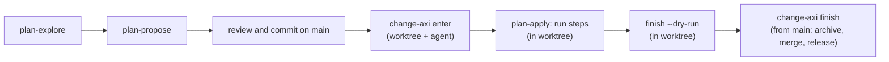

# plan-axi

Lightweight plan -> apply -> archive workflow for coding agents. Inspired by OpenSpec, with different trade-offs:

- No delta-spec merge. Docs in `docs/` are edited directly; archived changes are history only.
- No checkbox task lists. Task state and dependencies live in [tasks-axi](https://github.com/kunchenguid/tasks-axi).
- Deterministic CLIs that follow [AXI](https://github.com/kunchenguid/axi) (TOON output, content-first, idempotent, fail-loud).

## Packages

| Package | Status | Purpose |
|---|---|---|
| `packages/docs-axi` | v0.1 | `docs/` folder (domain, architecture, decisions): generated index, search, scaffolding, ADR numbering, checks, section read/write |
| `packages/change-axi` | v0.1 | change folders under `specs/changes/`: scaffold proposal/steps (required sections), section read/write, task deps, check, status, archive, finish (merge and release worktree) |
| `skills/` | v0 (prompt-only) | `plan-explore`, `plan-propose`, `plan-apply`, `plan-archive`, `plan-migrate-docs` |

## Layout this workflow assumes

```
<docs dir>/<sections>/                   shared human + agent docs (default docs/{domain,architecture,decisions}/), indexed in README.md there; see Config
specs/changes/active/<slug>/             proposal.md, NN-*.md step files, tasks.md (tasks-axi only)
specs/changes/archived/<date>-<slug>/
backlog.md                               repo level: one tasks-axi task per change
```

## Config (docs-axi)

Optional TOML, merged (arrays unioned): user `~/.config/plan-axi/config.toml` (or `$XDG_CONFIG_HOME/plan-axi/`), then repo `.plan-axi.toml`.

```toml
[docs]
ignore = ["todo/", "reports/", "**/*.draft.md"]   # paths relative to docs/; never indexed or reported

[docs.map]                                        # adopt legacy files in place, no moving
domain = ["domain.md", "domain-glossary.md", "features/"]
architecture = ["standards/"]
```

Agent profiles and step tiers (see `docs/domain/cli-quick-reference.md`):

```toml
[apply.agents.small]                          # profile: harness (pi), model, effort
harness = "pi"
model = "provider/id"
effort = "low"

[apply.tiers]                                 # a step's `Tier:` -> profile
small = "small"

[propose.tiers]                               # rules plan-propose uses to suggest tiers
standard = ["changes that touch db migrations"]
```

`change-axi enter <slug> <step> --agent <profile>` overrides the tier.

Commit format: tool commits are conventional (`chore(plan): start <slug>`, ...) with a `Change: <slug>` trailer; override under `[commit]` (see `docs/domain/cli-quick-reference.md`).

Docs layout (defaults: folder `docs`, sections `domain`, `architecture`, `decisions`, ADRs in `decisions`):

```toml
[docs]
dir = "documentation"                         # docs folder (default "docs")
sections = ["guides", "reference", "adr"]     # ordered section names
adr = "adr"                                   # section holding ADRs, or false for none

[docs.section.guides]
guide = "how-to docs for users"               # one-line meaning; custom sections need one
```

Show or change it with `docs-axi config` (flags `--dir`, `--sections`, `--adr`, `--guide name="text"` write the repo `.plan-axi.toml`). Skills read the layout from `docs-axi config`. After changing `dir` or `sections` on a repo with docs, run `docs-axi migrate` (see the `plan-migrate-docs` skill) to move existing files.

Always skipped: dot-entries, `node_modules/`, `_build/`, `_site/`, `site/`, `dist/`, `build/`. Files outside the layout are `UNMANAGED` warnings (exit 0). Mapped docs missing frontmatter or with odd names are warnings too.

## Section editing (docs-axi and change-axi)

Agents write and read single `##` sections instead of whole files: `sections`, `show --section`, `write --section` (stdin/`--body`), `append`. Selectors: `Heading`, `Parent/Child`, `Heading#2`. Writes never echo the body. `change-axi spec proposal|step` lists required sections; `change-axi check` errors on missing or empty ones.

## Quick start

```sh
npm install && npm run build
npm link -w packages/docs-axi -w packages/change-axi   # docs-axi, change-axi on PATH
npm run skills:install                                  # skills for your agent
```

The packages are not published to npm; build and `npm link` is the only install path. Skills call the binaries directly and stop if they are missing.

Plan by hand (agents do the same through the skills):

```sh
change-axi new split-auth "Split the auth module"
printf 'Token code is tangled with sessions.' | change-axi write split-auth proposal --section Why
change-axi step add split-auth "Extract token store" --owns src/auth/tokens/
change-axi dep split-auth 02-api --on 01-extract-token-store
change-axi check split-auth --waves      # verify before you commit the plan
```

After committing the plan on main, launch it: `change-axi enter split-auth` starts the change, leases a worktree and runs your agent there (set `[apply] agent` in `.plan-axi.toml`, or it autodetects pi, claude, codex, gemini, opencode). `change-axi setup` adds an AGENTS.md block so agents know to use `plan-apply` on a change branch.

When every step is done, preview from the worktree with `change-axi finish split-auth --dry-run` (checks rebase and archive readiness; rebase on the default branch if it asks). Then, from the main checkout, run `change-axi finish split-auth`: it archives the change on its branch if needed (tasks done, Docs impact updated), fast-forward merges the branch into the default branch, and returns the worktree. Add `--delete-branch` to remove the merged branch, `--skip-docs-check` to skip the docs check. `change-axi archive` alone archives without merging.

Verify a plan: `change-axi check <slug>` (exit 1 on errors), `change-axi status <slug>`, `docs-axi check`, then read `git diff`. Docs: [docs/](docs/README.md). Contributing: [CONTRIBUTING.md](CONTRIBUTING.md).

## Skills

Install with `npm run skills:install` (symlinks `skills/*` into `~/.agents/skills`, which pi and other agents read; idempotent; a skill that already exists, for example linked from another checkout, is skipped with a note and never replaced). Remove with `npm run skills:uninstall`. Use `node scripts/install-skills.mjs --dir <path>` for another location. They call `tasks-axi` (pin `0.2.6`) and `docs-axi`.

Flow:



`plan-explore` is read-only and reads `docs/`. `plan-propose` writes the plan without committing. `change-axi enter` = start + treehouse worktree + agent. `plan-archive` covers the archive step on its own.
